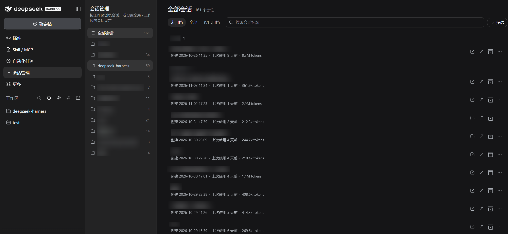
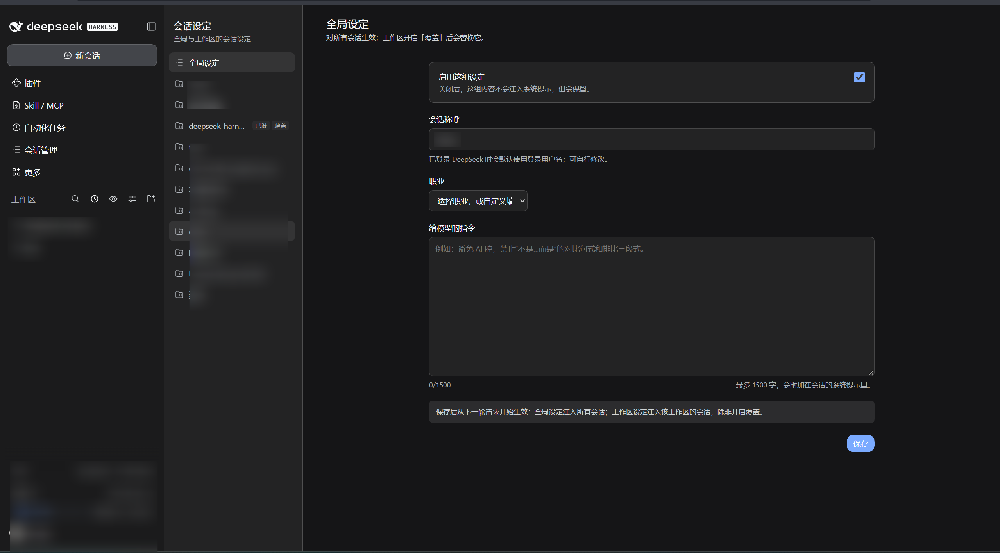
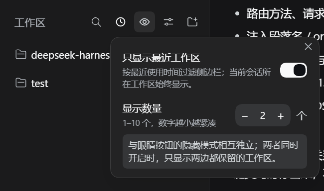
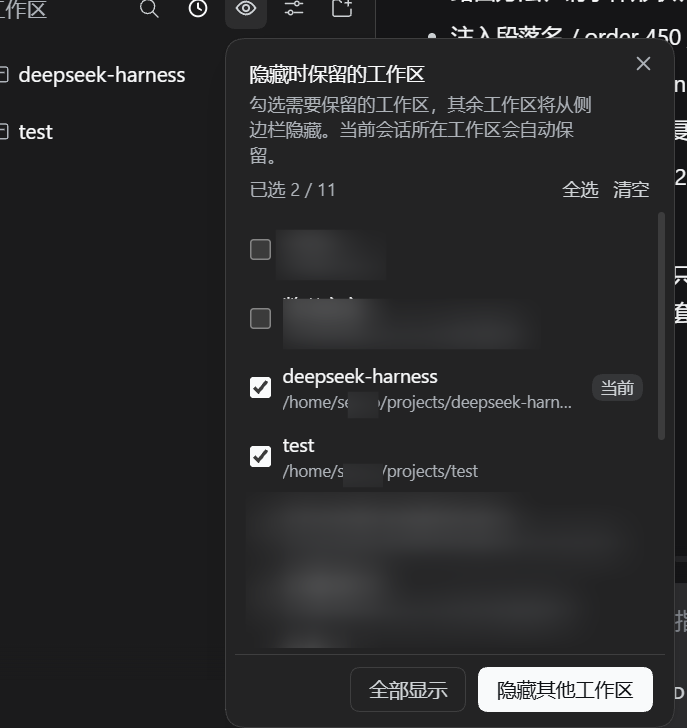

# dsh-session-manager

> DSH Web UI 的会话管理与会话设定插件。

**版本 1.0.0** · 兼容 DSH ≥ 0.2.0-rc.2 · Node ≥ 22.13.0 · 单包（Host + Client）

在左侧导航栏添加一个**会话管理**入口（按工作区浏览会话,支持批量管理）。

在侧栏「更多」菜单里添加一个**会话设定**入口（支持设置Agent 全局 / 工作区两层的称呼、职业、长期指令）。

在工作区栏添加了两种过滤方式以简洁工作区视图。一种为只显示最近x个使用的工作区，一种为显示特定的工作区。
 
每个功能独立运行，可在插件页设置里勾选想要生效的功能。改完不需要重启 `dsh web`。

---

## 目录

1. [插件目标](#1-插件目标)
2. [功能总览](#2-功能总览)
3. [安装与卸载](#3-安装与卸载)
4. [快速上手](#4-快速上手)
5. [会话管理页](#5-会话管理页)
6. [会话设定](#6-会话设定)
7. [侧栏过滤](#7-侧栏过滤)
8. [功能开关](#8-功能开关)
9. [数据与存储](#9-数据与存储)
10. [HTTP API](#10-http-api)
11. [Agent 工具](#11-agent-工具)
12. [系统提示注入](#12-系统提示注入)
13. [兼容性与运行环境](#13-兼容性与运行环境)
14. [安全与隐私](#14-安全与隐私)
15. [故障排查](#15-故障排查)
16. [开发](#16-开发)
17. [版本历史](#17-版本历史)
18. [许可](#18-许可)

---

## 1. 插件目标

该插件旨在解决以下问题：

- **会话冗杂**：官方侧栏按工作区列会话，但没有归档筛选、标题搜索、批量操作和只读预览。本插件提供独立的「会话管理」页（左侧栏「会话管理」，排在「自动化任务」下方，`sidebar.panellist` order 11）。
- **DSH原生没有个性化人设功能**：DSH 没有内建的「模型该怎么称呼我 / 我的职业 / 长期指令」持久设置。本插件按**全局**和**工作区**两级保存，并在每轮请求组装系统提示时注入匹配会话。
- **工作区繁多，在工作区栏堆积，影响视觉体验**：合并原 `dsh-workspace-focus` 的「最近 N 个工作区」与「按保留清单隐藏工作区」两种官方侧栏过滤。
- **都要可关**：四个功能各有开关（`page` / `settings` / `sidebarRecent` / `sidebarHide`），关闭后入口与数据都保留，只是页面路由、提示注入或侧栏按钮停用。

插件是**单包混合半插件**：`lib/index.js` 是 Host 半（路由、存储、系统提示注入、agent 工具），`lib/client.js` 是 Client 半（全部 UI、侧栏过滤、插件配置页）。

## 2. 功能总览

| 模块           | 入口                       | 作用                                                                                    | 开关            |
| -------------- | -------------------------- | --------------------------------------------------------------------------------------- | --------------- |
| 会话管理页     | 左侧导航「会话管理」       | 按工作区浏览会话；归档三态 + 标题搜索；行内重命名 / 归档 / 置顶；批量归档；全宽只读预览 | `page`          |
| 会话设定页     | 侧栏「更多」→「会话设定」  | 全局 / 工作区两级的称呼、职业、指令；工作区可覆盖全局；注入系统提示；agent 可读可写     | `settings`      |
| 最近工作区过滤 | 官方侧栏工作区栏的时钟按钮 | 只显示最近使用的 1–10 个工作区（默认 5）                                                | `sidebarRecent` |
| 主动隐藏工作区 | 官方侧栏工作区栏的眼睛按钮 | 按保留清单隐藏其它工作区，当前会话所在工作区自动保留                                    | `sidebarHide`   |

四个开关都在 **左上角插件 → `dsh-session-manager`（或者会话管理插件） 行 → 往下拉找到「配置」** 里，保存即生效。

## 3. 安装与卸载

### 3.1 前置条件

- 已安装并运行 `dsh web`，版本 ≥ **0.2.0-rc.2**（`package.json` 的 `dsh.compatibility.dsh`）。
- Node.js ≥ **22.13.0**。
- （本地安装可选）本目录的绝对路径，例如 `/path/to/dsh-session-manager`。

### 3.2 方式 A：让 agent 安装（需要批准）

告诉 Agent：帮我安装 dsh 插件 https://github.com/Tsechiyuan/dsh-session-manager

### 3.3 方式 B：手动安装

1. 在插件页点击增加插件，输入仓库地址 https://github.com/Tsechiyuan/dsh-session-manager;
2. 本地开发也可以填插件目录的绝对路径。

3. 重启 `dsh web`（新 bundle 一般需要重启；之后只改 Client 半可刷新页面生效，改 Host 半仍需重启）。

4. 打开左侧栏「会话管理」，或侧栏「更多」→「会话设定」。


### 3.4 卸载

从 `dsh.profile.bundles` 删除 `"dsh-session-manager"`，执行：

```bash
dsh plugin --profile web remove dsh-session-manager
```

然后重启 `dsh web`。存储文件 `$DSH_HOME/storages/session_manager_settings.json` 不会被自动删除，需要时可以告诉Agent手动删。

## 4. 快速上手

1. 打开左侧栏 **会话管理**：左栏是「全部会话 / 未分组 / 各工作区」，右栏是当前范围的会话列表。
2. 侧栏 **更多 → 会话设定**，填一份 **全局设定**（称呼、职业、指令），点「保存」。页面会提示「会话设定已保存，将从下一轮请求开始注入」。
3. 在任意会话里让模型调用 `session_settings_get`：`effectivePrompt` 应包含「## 会话设定」段落，`sources` 为 `global`。
4. 选一个工作区，填一份不同的称呼；先不打开「覆盖全局设定」→ `sources` 为 `global+workspace`；再打开覆盖 → `sources` 变为 `workspace`。
5. 到插件页把某个开关关掉再打开，观察入口 / 侧栏按钮立即变化（不需要重启）。

> 全局设定会影响所有没有覆盖它的会话。测试值用完请及时「清除设定」。

## 5. 会话管理页

### 5.1 布局与范围

- 左侧栏「会话管理」进入全宽页面，左工作区 / 右会话列表。
- 范围列表：**全部会话**、**未分组**、每个工作区（带会话数）。
- 列表隐藏 `origin === 'subagent'` 的子代理会话和空白会话。
- 打开另一个页面（如设定页）通过导航切换；从列表点「打开会话」会切回对话视图，管理页关闭，再点导航栏「会话管理」即可回来。

### 5.2 筛选与搜索

- **归档三态**：默认「隐藏已归档」、可切「全部」、可切「仅归档」。
- **标题搜索**：按标题子串过滤当前范围。
- 切换范围 / 筛选后，滚动位置与状态在进入详情再返回时保留。

### 5.3 行信息与时间戳

每行显示：标题、置顶 / 运行中 / 已归档状态、创建时间、上次使用时间、工作区名、token 用量。

| 时间         | 来源                                                          | 说明                                                           |
| ------------ | ------------------------------------------------------------- | -------------------------------------------------------------- |
| 创建时间     | Host 路由 `GET /times` 读取会话 header 的 `createdAt`（毫秒） | 客户端会话列表本身只有 `updatedAt`；只读查询，**不会激活会话** |
| 上次使用时间 | `sessionListMetadata.lastPromptAt`                            | 没有则回退 `updatedAt`                                         |

列表显示相对时间（几分钟前 / 几天前），悬停可看精确时间；详情页顶部同时显示两者的绝对时间与相对时间。

### 5.4 行操作

点行进入只读详情。行尾按钮：

- **重命名**（铅笔）：输入后按 Enter 或点「重命名」。走 `ctx.sessions.using(sessionId, { source: 'workspaceOperation' }, ...)`，只 `retain` + 等 `ready`，**不 `activate`、不唤醒 Agent**；标题同步到官方工作区栏。
- **打开会话**：切回对话视图。已归档会话的「打开」禁用，需先取消归档。
- **归档 / 取消归档**：归档仍在运行的会话会先弹确认，确认后「停止并归档」。
- **⋯ 更多**：置顶 / 取消置顶、复制会话 ID。

「置顶」走 `ctx.workspaces.pinSession`，与官方工作区栏会话行 `⋯` 菜单里的「置顶会话」是同一份 Host 状态，两边实时共享。

### 5.5 多选与批量

点工具条「多选」进入选择模式：勾选若干会话后可「批量归档 / 批量取消归档 / 全选当前 / 清除选择」。批量归档遇到运行中的会话会先确认，确认后统一「停止并归档」。

### 5.6 只读详情

- 全宽二级页，默认显示最近 **30** 条用户 / 助手消息；「加载更早」每次再取 30 条。
- 工具调用折叠成一行，可展开查看参数与结果；`thinking` 不展示。
- 顶部有返回（保留列表筛选与滚动位置）、打开、归档 / 取消归档、置顶、复制 ID。
- 通过 `remote.session.events` 分页拉取历史，**不调用** `ctx.sessions.retain()`，所以打开详情不会激活会话、不会唤醒 Agent。

### 5.7 特殊说明

- **不支持删除会话**：DSH 目前没有删除会话的 Host / Client API（CLI 也没有 session 子命令）。请用「归档」代替（可撤销、不丢数据）。
- 只读预览只渲染用户消息与助手最终文本，仅作为管理会话内容时的参考。

## 6. 会话设定

### 6.1 两层模型

设定存两份：**全局设定** 一份，**每个工作区** 一份（可选）。会话按它所属的工作区解析生效值：

| 场景                                      | 注入内容                     | `sources`             |
| ----------------------------------------- | ---------------------------- | --------------------- |
| 未分组会话 / 子代理会话                   | 只有全局设定                 | `global` 或 `none`    |
| 工作区设定存在，`override=false`          | 全局在前、工作区在后叠加     | `global+workspace`    |
| 工作区设定存在，`override=true`           | 只注入工作区设定，全局被覆盖 | `workspace` 或 `none` |
| 工作区 `override=true` 且工作区总开关关闭 | 什么都不注入                 | `none`                |
| 全局总开关关闭、工作区不覆盖              | 只注入工作区设定             | `workspace`           |

要点：

- 工作区**不覆盖**时，全局与工作区叠加；工作区总开关关闭只是跳过工作区那一段，全局仍然生效。
- 工作区**开启覆盖**后，全局对该工作区的会话完全失效；此时若工作区设定也关闭，就什么都不注入。
- 未分组会话与子代理会话**只受全局设定影响**（不继承父会话——设定本身没有按会话的版本）。

### 6.2 表单与限制

设定页左栏是「全局设定 + 各工作区」；已配置过的范围显示「已设」标记，工作区开启覆盖时额外显示「覆盖」。右栏是当前范围的表单：

| 字段                        | 限制      | 说明                                        |
| --------------------------- | --------- | ------------------------------------------- |
| 总开关 `enabled`            | 布尔      | 关闭后该范围不参与注入                      |
| 会话称呼 `name`             | ≤ 40 字   | 注入为「请称呼我为「…」」                   |
| 职业 `occupation`           | ≤ 60 字   | 8 个预设或「自定义」                        |
| 给模型的指令 `instructions` | ≤ 1500 字 | 实时字数计数                                |
| 覆盖全局 `override`         | 仅工作区  | true = 只注入工作区设定；false = 与全局叠加 |

职业预设：教师、学生、工程师、产品经理、设计师、运营、研究员、自由职业（另有「自定义…」）。

保存按钮在底部；「清除设定」删除当前范围的整份记录（工作区记录从文件中删除，全局置为 `null`）。

### 6.3 账号名预填

「会话称呼」为空、且当前环境已登录 DeepSeek 账号时，打开表单会用登录用户名自动预填（可修改；**只有点保存才会写入存储**）。未登录、账号接口不可用、或已有非空称呼时保持原值。

### 6.4 生效时机

- 保存后从匹配会话的**下一轮请求**开始生效（不是立刻改写已在生成的回复）。
- 每轮组装系统提示时，按 `context.agent.session.id` 找到会话所属工作区，再解析全局 / 工作区设定。
- 未分组会话、子代理会话只看全局；设定不随会话 fork 复制。

### 6.5 注入示例

假设全局设定为称呼「凉」、职业「贝斯手」，工作区 `deepseek-harness` 另有一份称呼「凉」的设定且未覆盖，注入到系统提示的文本形如：

```markdown
## 会话设定
以下是用户为本会话保存的个性化设定，请按此调整回复：
### 全局设定
- 会话称呼：请称呼我为「凉」。
- 我的职业：贝斯手。请在讲解深度、术语和举例上适配这一身份。
- 给模型的指令（请严格遵守）：
  回答用中文；术语第一次出现时用一句话解释。
### 工作区设定（deepseek-harness）
- 会话称呼：请称呼我为「凉」。
```

指令的每一行会缩进两个空格；空行保持为空。没有任何有效内容时，整个段落不注入（系统提示里不出现「会话设定」）。

### 6.6 保存与清除

- 保存成功提示：「会话设定已保存，将从下一轮请求开始注入」。
- 清除成功提示：「会话设定已清除」。
- 清空一个工作区的记录后，该工作区回退到「跟随全局」；清空全局后，未覆盖的工作区只剩工作区那一段。

## 7. 侧栏过滤


### 7.1 最近工作区（时钟按钮）

- 只显示最近使用的 N 个工作区，N 在设置里调 1–10，默认 **5**。
- 当前会话所在工作区始终显示。

### 7.2 主动隐藏工作区（眼睛按钮）

- 勾选「保留」的工作区，其余从侧栏隐藏；当前会话所在工作区自动保留。
- 未勾选任何工作区时，应用后隐藏全部工作区（当前会话所在工作区除外）。

### 7.3 两种过滤的关系

两者独立生效；同时开启时，只显示两边都保留的工作区。


## 8. 功能开关

位置：**插件页 → `dsh-session-manager` 行 → 「配置」**（行内按钮 `aria-label` 为「配置 dsh-session-manager」）。四个开关分别对应：

| 开关 key        | 界面名称           | 关闭后的行为                                                                                                                                                   |
| --------------- | ------------------ | -------------------------------------------------------------------------------------------------------------------------------------------------------------- |
| `page`          | 会话管理页         | 导航入口保留，页面显示「功能已关闭」；`GET /times` 返回 404                                                                                                    |
| `settings`      | 会话设定页         | 侧栏「更多」菜单行保留，页面显示「功能已关闭」；`/settings`、`/settings/clear` 返回 404；系统提示不再注入；两个 agent 工具报「会话设定功能已在插件配置中关闭」 |
| `sidebarRecent` | 只显示最近的工作区 | 官方侧栏的时钟按钮 / 设置项立即消失，重新开启立即恢复                                                                                                          |
| `sidebarHide`   | 主动隐藏工作区     | 官方侧栏的眼睛按钮 / 设置项立即消失，重新开启立即恢复                                                                                                          |

关闭页面功能后的提示文案：

> 功能已关闭
> 此功能已在「插件 → dsh-session-manager → 配置」中关闭。回到插件页打开开关即可恢复。

机制：

- 开关存 Host（`GET/POST /_dsh/session-manager/features`），四个默认全开。
- Host 半在**每次请求 / 每次工具调用 / 每次组装系统提示**时读取开关，所以改完立即生效。
- Client 半保存后立即更新本地快照并刷新侧栏过滤，无需刷新页面。
- `features` 路由本身**始终可用**，避免关掉页面后无法改回。
- 只有改代码才需要重启 `dsh web`；改开关、改设定都不需要。

## 9. 数据与存储

### 9.1 位置

```
$DSH_HOME/storages/session_manager_settings.json
```

`DSH_HOME` 未设置时回退 `~/.dsh`。文件在第一次保存时创建；不存在时使用默认值（无设定，四个开关全开）。

### 9.2 格式

```json
{
  "version": 2,
  "savedAt": 1793705236327,
  "global": {
    "enabled": true,
    "name": "凉",
    "occupation": "贝斯手",
    "instructions": "回答用中文。",
    "updatedAt": 1793705236327
  },
  "workspaces": {
    "<workspaceId>": {
      "enabled": true,
      "name": "凉",
      "occupation": "DSH 插件开发者",
      "instructions": "",
      "updatedAt": 1793705236327,
      "override": false
    }
  },
  "features": {
    "page": true,
    "settings": true,
    "sidebarRecent": true,
    "sidebarHide": true
  }
}
```

- `global` 可以为 `null`（未保存）；`workspaces` 只包含已保存过的工作区。
- `updatedAt` / `savedAt` 为毫秒时间戳；保存时由 Host 写入。
- 文件名固定；读取时忽略未知字段，缺失字段用默认值补齐。

### 9.3 浏览器侧存储

侧栏过滤偏好不写服务端，存在浏览器 localStorage：

| 键                             | 内容                                                                   |
| ------------------------------ | ---------------------------------------------------------------------- |
| `dsh-workspace-focus.prefs.v1` | `recentOnly`、`limit`、`hideActive`、`keepWorkspaces`、`keepUngrouped` |

- 作用域：当前浏览器 + 当前 origin（`127.0.0.1` 与 `localhost` 不共享）；换浏览器不同步。
- 清除：浏览器站点数据，或 `localStorage.removeItem('dsh-workspace-focus.prefs.v1')`；恢复默认（最近 5 个、不隐藏、空保留清单）。
- 与 9.1 的服务端 JSON 互不影响：删 settings 文件不影响侧栏过滤，反之亦然。


## 10. HTTP API

前缀：`/_dsh/session-manager`。所有响应都是 `{ok:true,value}` 或 `{ok:false,error:{code,message}}` 信封。**只接受本机 loopback 请求**（见 §14）。

| 方法           | 路径              | 作用                           | 受哪个开关控制 |
| -------------- | ----------------- | ------------------------------ | -------------- |
| `GET` / `HEAD` | `/times`          | 全部会话的创建时间映射         | `page`         |
| `GET` / `HEAD` | `/settings`       | 读取 `{ global, workspaces }`  | `settings`     |
| `POST`         | `/settings`       | 局部更新全局或某个工作区的设定 | `settings`     |
| `POST`         | `/settings/clear` | 清除全局或某个工作区的设定     | `settings`     |
| `GET` / `HEAD` | `/features`       | 读取四个功能开关               | 始终可用       |
| `POST`         | `/features`       | 更新功能开关                   | 始终可用       |

### 10.1 读取创建时间

```bash
curl -s http://127.0.0.1:3080/_dsh/session-manager/times
```

```json
{"ok":true,"value":{"times":{"session-b3deb3d5-a501-47c5-b1c5-3964c43e6396":1793713568076}}}
```

没有 `sessionQuery` 服务时返回 503：

```json
{"ok":false,"error":{"code":"unavailable","message":"session query service is not available"}}
```

### 10.2 读取设定

```bash
curl -s http://127.0.0.1:3080/_dsh/session-manager/settings
```

```json
{
  "ok": true,
  "value": {
    "global": null,
    "workspaces": {}
  }
}
```

### 10.3 写入设定

全局（只传要改的字段，其余保持原值）：

```bash
curl -s -X POST http://127.0.0.1:3080/_dsh/session-manager/settings \
  -H 'content-type: application/json' \
  -d '{"scope":"global","settings":{"enabled":true,"name":"凉","occupation":"高中数学竞赛教练","instructions":"回答用中文。"}}'
```

工作区：

```bash
curl -s -X POST http://127.0.0.1:3080/_dsh/session-manager/settings \
  -H 'content-type: application/json' \
  -d '{"scope":"workspace","workspaceId":"<workspaceId>","settings":{"override":false,"name":"凉"}}'
```

响应会带回归一化后的完整 `settings`（含 `updatedAt`）：

```json
{"ok":true,"value":{"scope":"global","settings":{"enabled":true,"name":"凉","occupation":"高中数学竞赛教练","instructions":"回答用中文。","updatedAt":1793705236327}}}
```

- `scope` 必须是 `global` 或 `workspace`；`workspace` 必须带非空 `workspaceId`。
- `settings` 至少包含一个已知字段；未知字段被忽略，全部未知时报 400。
- 全局忽略 `override`；工作区保留。

### 10.4 清除设定

```bash
curl -s -X POST http://127.0.0.1:3080/_dsh/session-manager/settings/clear \
  -H 'content-type: application/json' \
  -d '{"scope":"workspace","workspaceId":"<workspaceId>"}'
```

```json
{"ok":true,"value":{"scope":"workspace","workspaceId":"<workspaceId>","cleared":true}}
```

`cleared:false` 表示本来就没有记录。

### 10.5 功能开关

```bash
curl -s http://127.0.0.1:3080/_dsh/session-manager/features

curl -s -X POST http://127.0.0.1:3080/_dsh/session-manager/features \
  -H 'content-type: application/json' \
  -d '{"features":{"settings":false}}'
```

`POST` 只改传入的键，其余保持不变；至少传一个已知键。

### 10.6 错误码

| HTTP | code                | 典型 message                                                                                                                                                                         |
| ---- | ------------------- | ------------------------------------------------------------------------------------------------------------------------------------------------------------------------------------ |
| 400  | `invalid_json`      | `request body is not valid JSON`                                                                                                                                                     |
| 400  | `invalid_settings`  | `name is longer than 40 characters` / `name must be a string` / `settings does not contain any known field` / `settings must be an object` / `scope must be "global" or "workspace"` |
| 400  | `invalid_workspace` | `workspaceId must be a non-empty string`                                                                                                                                             |
| 400  | `unknown_workspace` | `workspace does not exist`                                                                                                                                                           |
| 400  | `invalid_features`  | `body must be { features: {...} }` / `features must be an object` / `<key> must be a boolean` / `features does not contain any known field`                                          |
| 403  | `forbidden`         | `untrusted host`                                                                                                                                                                     |
| 404  | `not_found`         | `unknown route`（也可能是对应功能开关关闭）                                                                                                                                          |
| 413  | `payload_too_large` | `request body is too large`（上限 64 KiB）                                                                                                                                           |
| 500  | `internal`          | 未预期异常                                                                                                                                                                           |
| 503  | `unavailable`       | `session query service is not available`                                                                                                                                             |

## 11. Agent 工具

两个工具都注册在 Host 半，关闭 `settings` 开关时都直接报错：「会话设定功能已在插件配置中关闭」。

### 11.1 `session_settings_get`

无参数；只读**调用方所在会话**的生效设定。返回字段：

| 字段                             | 说明                                                    |
| -------------------------------- | ------------------------------------------------------- |
| `sessionId`                      | 当前会话 id                                             |
| `workspaceId` / `workspaceTitle` | 所属工作区（未分组时为空字符串）                        |
| `sources`                        | `none` / `global` / `workspace` / `global+workspace`    |
| `override`                       | 是否处于「覆盖全局」                                    |
| `effectivePrompt`                | 本轮实际注入系统提示的文本（空字符串表示不注入）        |
| `global`                         | `{configured, enabled, name, occupation, instructions}` |
| `workspace`                      | 上列字段 + `override`                                   |

典型用法：用户问「你现在怎么称呼我」，或排查「设定为什么没生效」。

### 11.2 `session_settings_update`

只写**当前会话所属工作区**的设定；全局设定只能由用户在页面修改。参数是任意子集：

| 参数           | 类型    | 说明                                        |
| -------------- | ------- | ------------------------------------------- |
| `enabled`      | boolean | 工作区设定总开关                            |
| `name`         | string  | 称呼，≤ 40 字                               |
| `occupation`   | string  | 职业，≤ 60 字                               |
| `instructions` | string  | 给模型的指令，≤ 1500 字                     |
| `override`     | boolean | true = 只注入工作区设定；false = 与全局叠加 |

返回与 `get` 相同的状态对象。错误：

- `会话设定功能已在插件配置中关闭`
- `session_settings_update 只能在会话内调用`
- `session_settings_update: 当前会话不属于任何工作区，无法写入工作区设定；请让用户在页面上修改全局设定`
- 400 `invalid_settings`（类型错误、超长等）

工具说明里明确要求「只在用户明确要求修改时才调用」，避免模型擅自改设定。

## 12. 系统提示注入

- 段落名：`session-manager:profile`
- `order`：**450**（人设 0 → 会话设定 450 → 计划策略 500 → 工具策略 1000+）
- `interpolate: false`（设定文本不做模板插值）
- 组装时机：每轮请求；按 `context.agent.session.id` 解析工作区
- 不注入的情况：`settings` 开关关闭、会话 id 缺失、没有有效内容、工作区覆盖且工作区设置关闭

注入规则见 [§6.1](#61-两层模型)，格式见 [§6.5](#65-注入示例)。

> 设定内容会进入系统提示，对模型可见；不要在里面放密钥、口令等敏感信息。

## 13. 兼容性与运行环境

| 项       | 要求                                                                    |
| -------- | ----------------------------------------------------------------------- |
| DSH      | ≥ 0.2.0-rc.2（manifest `dsh.compatibility.dsh`）                        |
| Node.js  | ≥ 22.13.0                                                               |
| 运行形态 | `dsh web` 的 profile bundle（单包，含 Host + Client 半）                |
| 验证环境 | 开发机 dsh 0.2.2-rc.1 + Node 24.22.1（2026-11-04 完成 21 项端到端验收） |
| 界面语言 | 中文 / English（跟随 DSH 界面语言）                                     |
| 包状态   | `private: true`，未发布 npm                                             |

加载与重启规则：

- **只改 Client 半**（`lib/client.js` 及样式）：刷新页面即可；若同时跑着 `pnpm run dev:web`，前端会热更新，仍建议刷新确认。
- **改 Host 半**（`lib/index.js`）：必须重启 `dsh web`。
- **改功能开关 / 设定数据**：不需要重启。

## 14. 安全与隐私

- **只接受本机请求**：`dsh web` 的 raw 路由本身不走登录鉴权，因此插件自己做同源栅栏：`Host` 必须是 `localhost` / `127.0.0.1` / `[::1]`；`Sec-Fetch-Site: cross-site` 拒绝；带 `Origin` 时必须与 `Host` 一致。否则返回 403 `untrusted host`。
- **没有外发请求**：插件不访问网络、不上报遥测；会话标题、设定内容、创建时间都只在本机内存 / 本地文件里处理。
- **数据只落在本地**：`$DSH_HOME/storages/session_manager_settings.json`；备份、删除都由你控制。
- **模型可见**：设定会被注入系统提示；再次提醒不要放敏感信息。
- **全局作用域**：全局设定影响所有未覆盖它的会话，测试完及时清除。
- **删除约束**：DSH 没有删除会话的 API，插件不绕过；「归档」是唯一安全替代（可撤销、不丢数据）。

## 15. 故障排查

| 现象                           | 可能原因                                                   | 处理                                                        |
| ------------------------------ | ---------------------------------------------------------- | ----------------------------------------------------------- |
| `curl /features` 404           | Host 半没加载 / 版本过旧                                   | 检查 profile `bundles`，重启 `dsh web`                      |
| 侧栏没有「会话管理」           | Client 半没注入 / profile 未装                             | 重启服务 + 刷新；检查 `dsh.client.inject` 所需包是否齐全    |
| 页面显示「功能已关闭」         | 对应开关关闭                                               | 插件页 → `dsh-session-manager` →「配置」打开                |
| 打开管理页没有创建时间         | `/times` 不可达：功能关闭 / Host 半缺失 / 非 loopback 地址 | 用 `127.0.0.1`；查 features；重启                           |
| 保存设定报 `unknown_workspace` | `workspaceId` 不存在或已删除                               | 刷新页面重选工作区                                          |
| 保存后下一轮没生效             | 设定在下一轮才注入；或 `enabled=false` / 覆盖关系不符      | 用 `session_settings_get` 看 `sources` 与 `effectivePrompt` |
| 账号名没有预填                 | 未登录 / 账号接口失败 / 已有非空称呼                       | 确认「设置 → 账号」能看到用户名；刷新页面；看浏览器控制台   |
| 数据文件 JSON 坏了             | 手动编辑出错                                               | Host 会以空 store 启动并打 warning；修好 JSON 或从备份恢复  |
| 局域网打开缺功能               | raw 路由只接受 loopback                                    | 改用本机 `127.0.0.1` / `localhost` 访问                     |

## 16. 开发

### 16.1 目录结构

```
dsh-session-manager/
├─ package.json          # manifest：dsh.bundle.patch / dsh.client.inject / exports
├─ cordis.patch.yml      # profile bundle 的 insert 行
├─ lib/
│  ├─ index.js           # Host 半：times / settings / features 路由、存储、系统提示注入、两个工具
│  └─ client.js          # Client 半：两个页面 + 设定表单 + 插件配置页 + 侧栏过滤 + 样式
├─ locale/
│  ├─ zh.json            # 插件元数据（title / description）
│  └─ en.json
├─ templates/
│  └─ session-manager-settings.template.json
├─ icon.svg
└─ README.md
```

### 16.2 常用命令

```bash
npm run check   # node --check lib/index.js && node --check lib/client.js
```

### 16.3 本地开发

1. 按 §3.3 把本目录装进 web profile（本地开发常直接 link 该目录），保证 `dsh.profile.bundles` 含 `dsh-session-manager`。
2. 改 Client 半：刷新页面；若正在跑 `pnpm run dev:web`，客户端 bundle 会重建，仍建议刷新确认。
3. 改 Host 半：重启 `dsh web`。
4. 调试：
   - `curl -s http://127.0.0.1:3080/_dsh/session-manager/features`
   - `curl -s http://127.0.0.1:3080/_dsh/session-manager/settings`
   - 浏览器控制台过滤 `[dsh-session-manager]`（Host 日志）与 `dsm`（Client 类名 / 样式前缀）。
   - 侧栏过滤偏好：`localStorage.getItem('dsh-workspace-focus.prefs.v1')`（见 §9.3）。

### 16.4 发布检查清单

- [ ] `package.json` 版本号已更新（当前 `1.0.0`）
- [ ] `npm run check` 通过
- [ ] README / 版本历史更新
- [ ] 四个功能开关各关一次再开一次（入口、页面、侧栏按钮、工具报错）
- [ ] 全局 / 工作区设定保存、覆盖、清除各验证一次
- [ ] 重启 `dsh web` 后设定仍在（持久化）
- [ ] 测试数据已清除，基线已恢复
- [ ] 如需在 npm 分发：移除 `private` 并补 `publishConfig`

## 17. 版本历史

### 1.0.0 — 2026-11-04

- 首个稳定版本；本 README 重写为上线文档。
- **修复**：已登录 DeepSeek 账号时，「会话称呼」自动预填不生效——remote 方法返回的 `{ ok, value }` 信封没有被解开，`result.status` 恒为 `undefined`。现同时兼容信封（`result.ok` → `result.value.status === 'ready'` → `result.value.value.name`）与旧版直接返回 profile 的形状。


## 18. 许可

本包以 **MIT** 许可发布，许可证全文见仓库根目录的 [`LICENSE`](LICENSE)。`package.json` 保持 `private: true`，不发布到 npm；如需在 npm 分发，移除该字段并补全 `publishConfig`。
